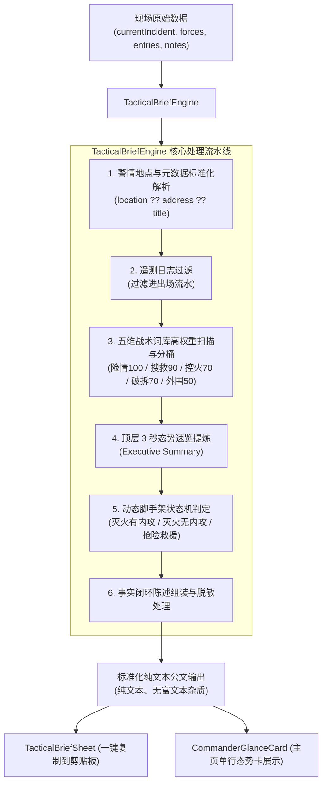

# 动态自适应战况速报引擎架构设计 (Dynamic Tactical Brief Engine)

* **作者:** shooter119 / WatchDog 架构组
* **日期:** 2026-11-08
* **状态:** 已批准 (Approved / In Implementation)
* **前置概念:** [`concepts_brief.md`](../../concepts_brief.md)

---

## 一、背景与问题陈述 (The Problem & Context)

在灭火与抢险救援现场，前方消防通讯员和指挥员需要向后方指挥中心、应急联动部门和政务协同群秒级同步战况速报。速报是现场外部调度指挥、力量增援与领导决策的第一手客观依据。

在实际作战中（如真机当前实测的「龙游县湖镇镇竺溪桥」抢险救援任务），现有的速报引擎暴露了三个底层缺陷：
1. **数据字段取值错误（盲区缺陷）**：
   - 警情实际地点存储于 `incident.location`，而引擎代码写死了 `incident.info['address']`，导致地点始终判空，输出荒谬的“事发地点：现场核实中”。
2. **战术情报遭到极端截断（99% 关键信息丢失）**：
   - 引擎仅倒排取最后 1 条日志，导致一线记录的“建筑有倒塌风险”、“搜救出 1 名被困人员”、“出水枪控制阵地”、“群众围观划定警戒区”等关键战报被完全丢弃，反而充斥着大量虚假和无关的死板套话（如明明搜救出人，速报却依然打印“未发现被困人员，暂无人员伤亡”）。
3. **公文脚手架死板、无法自适应作战场景**：
   - 在交通事故、建筑物倒塌或人员搜救等无需空呼内攻的抢险救援场景中，速报依然固定打印“内攻作业与空呼安全：暂无在场内攻作业人员”，严重挤占关键版面，违背各级指挥员对搜救进展与次生风险的核心关切。

---

## 二、方案总览 (Overview)

本方案面向**高级消防指挥员的核心决策视角**，将战况速报重构为**「高权重战术要事驱动的动态自适应公文引擎」**：
1. **纯端侧五维战术词库抽取**：建立结构险情、人命搜救、火势控制、破拆救援、外围保障 5 个维度的确定性权重词典与评分机制，多条核心要事分块保留并按时序组装；
2. **顶层 3 秒态势速览 (Executive Summary)**：在速报头部输出 1-2 行高密度核心要事提炼，让高级指挥官 3 秒纵览全局；
3. **动态公文脚手架伸缩 (Dynamic Scaffolding)**：按警情类型（火灾 vs 抢险）与内攻状态（有空呼 vs 无空呼）自动伸缩段落。抢险救援无内攻时，彻底隐藏空呼段落，空间全量让渡给搜救进展与现场险情；
4. **事实闭环陈述 (Positive Absence Affirmation)**：无伤亡或无险情时明确给出排查确认陈述，消除指挥盲区。

---

## 三、目标与非目标 (Goals & Non-Goals)

### 核心目标 (In-Scope Goals)
* **G1 [数据修复]**：精准提取警情位置（优先 `incident.location`，兼容 `address` 与 `title`）；
* **G2 [高权重战术提取]**：实现五维战术词库（极端险情/结构风险、人命搜救/人员伤亡、火势控制/灭火阵地、抢险破拆/特殊处置、外围警戒/供水保障）的纯端侧高权重提取与分块聚合；
* **G3 [动态脚手架]**：实现火灾扑救（含内攻）、火灾扑救（无内攻）、抢险救援、社会救助四种作战形态的公文自适应排版；
* **G4 [指挥官态势速览]**：公文顶部提供 1-2 行【核心要事】提炼；
* **G5 [纯端侧零依赖]**：100% 纯 Dart 实现，无后端 API 依赖，断网离线毫秒级（< 2ms）响应，零发热、零幻觉；
* **G6 [质量门禁]**：单元与部件测试 100% 覆盖，保持 analyze 0 报警，测试只增不减。

### 明确非目标 (Out-of-Scope Non-Goals)
* **NG1**：不引入端侧重型大语言模型（LLM），保证现场极端环境下的稳定与省电；
* **NG2**：不修改后端数据库表结构或 REST 接口契约；
* **NG3**：不改变既有空气呼吸器可用时间的倒计时核心算法。

---

## 四、技术方案 (Technical Plan)

### 1. 架构总览与数据流

整个战况速报引擎完全运行在 Flutter 端侧内存中，为无状态、无副作用的纯计算领域服务：



---

### 2. 领域模型设计

新增核心数据载体，完全解耦 UI 与解析：

```dart
/// 五维战术情报汇总结构体
class TacticalIntelligenceSummary {
  /// 极端险情与结构风险（倒塌、爆炸、有毒、断电等）
  final List<String> hazards;

  /// 人命搜救与伤亡处置（搜救出人员、移交120、排查完毕等）
  final List<String> lifeSafety;

  /// 火势控制与灭火阵地（出水枪、堵截、排烟降温等）
  final List<String> suppression;

  /// 抢险破拆与技术处置（破拆、顶撑、关阀堵漏等）
  final List<String> technicalRescue;

  /// 外围警戒与供水保障（交警管制、消火栓供水等）
  final List<String> perimeterAndSupport;

  const TacticalIntelligenceSummary({
    this.hazards = const [],
    this.lifeSafety = const [],
    this.suppression = const [],
    this.technicalRescue = const [],
    this.perimeterAndSupport = const [],
  });

  bool get hasCriticalHazards => hazards.isNotEmpty;
  bool get hasRescueProgress => lifeSafety.isNotEmpty || technicalRescue.isNotEmpty;
}
```

---

### 3. 高权重战术词库算法实现

通过纯 Dart 正则与前缀匹配，对剔除纯进退场流水后的 `Note` 进行语义分桶。每类至多保留最新 2 条高价值事件，既保证信息丰满度，又杜绝刷屏冗长：

```dart
static TacticalIntelligenceSummary extractIntelligence(List<Note> notes) {
  final hazards = <String>[];
  final lifeSafety = <String>[];
  final suppression = <String>[];
  final technicalRescue = <String>[];
  final support = <String>[];

  // 逆序遍历日志（最新的优先）
  for (final n in notes.reversed) {
    final text = n.text.trim();
    if (text.isEmpty) continue;
    
    // 过滤系统遥测流水
    if (_isTelemetryNote(text)) continue;

    // A. 极端险情与结构风险 (权重 100)
    if (_hazardRegex.hasMatch(text)) {
      if (hazards.length < 2 && !hazards.contains(text)) hazards.add(text);
      continue;
    }

    // B. 人命搜救与伤亡 (权重 90)
    if (_lifeSafetyRegex.hasMatch(text) || n.category == '搜救') {
      if (lifeSafety.length < 2 && !lifeSafety.contains(text)) lifeSafety.add(text);
      continue;
    }

    // C. 火势控制与灭火阵地 (权重 70)
    if (_suppressionRegex.hasMatch(text) || n.category == '出水') {
      if (suppression.length < 2 && !suppression.contains(text)) suppression.add(text);
      continue;
    }

    // D. 抢险破拆与技术处置 (权重 70)
    if (_technicalRescueRegex.hasMatch(text) || n.category == '破拆') {
      if (technicalRescue.length < 2 && !technicalRescue.contains(text)) technicalRescue.add(text);
      continue;
    }

    // E. 外围警戒与供水 (权重 50)
    if (_supportRegex.hasMatch(text) || n.category == '供水') {
      if (support.length < 2 && !support.contains(text)) support.add(text);
      continue;
    }
  }

  return TacticalIntelligenceSummary(
    hazards: hazards,
    lifeSafety: lifeSafety,
    suppression: suppression,
    technicalRescue: technicalRescue,
    perimeterAndSupport: support,
  );
}
```

---

### 4. 动态脚手架状态机 (Dynamic Scaffolding Logic)

根据警情类型和现场内攻情况，判定生成哪套模板：

```dart
final bool isRescue = incident?.specificType.contains('抢险') == true ||
    incident?.originalCategory.contains('抢险') == true ||
    incident?.situation.contains('抢险') == true;

final bool hasActiveEntries = entries.any((e) => e.isActive);

// 脚手架分支策略：
// 1. 若 isRescue && !hasActiveEntries：
//    - 抬头：【抢险救援现场速报】
//    - 一、力量到场与现场展开
//    - 二、现场险情与风险控制 (若有倒塌等险情置顶醒目)
//    - 三、人员搜救与转移送医 (若搜救出人突出陈述)
//    - 彻底隐藏“内攻作业与空呼安全”段落！
// 2. 若 !isRescue && hasActiveEntries：
//    - 抬头：【火灾扑救战况速报】
//    - 一、参战力量与火场态势
//    - 二、现场险情与结构安全
//    - 三、搜救排查与人员伤亡
//    - 四、内攻人员与空呼管控 (短板木桶倒计时)
// 3. 若 !isRescue && !hasActiveEntries：
//    - 同样省略空呼安全段，标明“外围控火，暂未派员内攻”。
```

---

### 5. 地点提取修正

```dart
static String extractLocation(Incident? incident) {
  final loc = incident?.location.trim();
  if (loc != null && loc.isNotEmpty) return loc;

  final address = incident?.info['address']?.toString().trim();
  if (address != null && address.isNotEmpty) return address;

  final title = incident?.displayName.trim();
  if (title != null && title.isNotEmpty) return title;

  return '现场核实中';
}
```

---

## 五、备选方案权衡 (Alternatives Considered)

### 备选 1：端侧轻量大模型总结 (On-Device LLM Summarization)
* **方案描述**：在移动端运行本地量化小模型（如 Gemma-2B / Qwen-1.5B）进行自然语言总结生成公文。
* **否决理由**：在实战火场高温、强电磁干扰和手机发热降频场景下，大模型推理消耗大量电量（5~10 秒延迟、数瓦功耗），且存在概率性幻觉（如将未受困篡改为伤亡人数），对生命安全指挥带来不可控风险。故坚决否决，选择确定性纯算法。

### 备选 2：云端后端实时代理生成 (Server-Side Agent Generation)
* **方案描述**：客户端将所有日志发回后端，由后端调用云端模型或复杂规则引擎生成后再回传。
* **否决理由**：违反 `[safety:dual-mode-resilience]` 核心不变量。火场在地下室、隧道、偏远山区极易发生断网或信号微弱，速报生成必须完全离线自治。

### 备选 3：全量日志时间轴流水 (Full Unfiltered Chronological Dump)
* **方案描述**：将所有日志不做关键词筛选，直接按时间先后顺序全文平铺在速报中。
* **否决理由**：现场日志往往包含大量琐碎沟通（如“对讲机调至10频道”、“车上拿撬棍”），若全量平铺会导致速报长达数千字，彻底失去“速报”的高密度决断价值。

---

## 六、关键决策记录 (Key Decisions)

1. **分桶规则的确定性与可测性**：五维词库采用严格测试覆盖的静态正则匹配，具备 100% 单元测试可重现性。
2. **正面缺失确认原则 (Positive Absence Affirmation)**：在无险情或无伤亡时，绝不留白，必须明确输出排查确认结论（如“未收到人员伤亡报告”）。
3. **空间让渡原则**：抢险救援无内攻时，空呼安全板块的显示权重降为 0，空间 100% 腾退给现场搜救与破拆处置。
