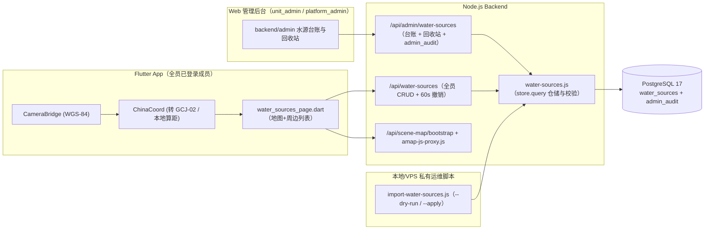

# 大队级自建水源库与周边水源查找

*   **Author:** shooter119
*   **Status:** Approved
*   **Date:** 2026-11-21

--------------------------------------------------------------------------------

## Overview

本设计在 WatchDog 内建立按大队（`unit_id`）隔离共享的自有水源库，包含手机端独立「周边水源」查询维护页、Web 管理后台水源台账与回收站，以及存量高德工作地图数据的两阶段一次性脱敏清洗入库流程。上线后，消防员无需切出 WatchDog 打开高德工作地图小程序，即可在单一应用内基于当前定位查找周边市政消火栓、天然水源（含消防水池）和水泵接合器，并在日常巡检或实战后随时维护点位状态。

## The Problem

目前基层大队依赖高德工作地图小程序管理自采的约 500 条辖区水源点位，在实战和日常维护中存在以下具体问题：

1. **多 App 切换打断处置节奏**：WatchDog 已集成语音处置、人员气瓶监控、火场日志、重点单位与现场地图，但找水源仍必须跳出到高德小程序，实战中切屏和小程序冷启动耗时且容易中断现场操作。
2. **存量台账口径混乱、存在误导风险**：现有高德工作地图导出表依赖颜色和自由文本表达状态，已出现颜色与描述矛盾的脏数据（标红却写「无水」、标黄却写「无损坏有水」）、同坐标重复录入点、无效经纬度，以及未区分的消防水池与水泵接合器。
3. **第三方工具绑定与管理割裂**：水源数据存储在高德工作地图内部，无法与 WatchDog 现有大队账号体系、操作审计和后台台账关联；历史照片依赖高德外链，脱离小程序后存在失效风险。

**拟议解法**：针对上述问题，分别在 PostgreSQL 中建大队级三类水源表、提供两阶段脱敏清洗脚本（导出冲突人工核定后幂等入库，丢弃历史照片）、在 App 端独立新建「周边水源」页支持定位查水与全员维护（软删 + 60 秒撤销），并在 Web 管理后台沿用管理员准入提供台账巡检与回收站恢复。

## Goals

*   **单一入口快速查水**：消防员在 WatchDog 内打开「周边水源」页，无需切换其他应用，即可基于手机当前定位查看周边水源的地图分布与按距离升序排列的列表（含类别、可用状态、取水方式与备注首行）；正常 4G/Wi-Fi 下，2000 条以内样本的接口加载与端侧排序目标在 500ms 内完成（含定位与首屏渲染目标在 2 秒内）。
*   **三类水源数据模型**：
    *   市政消火栓（`hydrant`）：二元可用状态（可用 / 不可用）+ 自由备注（如缺闷盖、水压偏低、压力值）。
    *   天然水源（`natural`，含消防水池）：二元可用状态 + 多选取水方式（手抬泵吸水 / 消防车靠近取水 / 远程供水系统直接取水，至少选 1 项）+ 自由备注（如水池容量、取水平台尺寸）。
    *   水泵接合器（`pump_connector`）：二元可用状态 + 自由备注（如对应楼栋、接口情况）。
*   **全员维护 + 防误删可追溯**：本单位所有已登录消防员可在 App 端新增点位、切换状态、修改备注、调整坐标和软删除（原删除人 60 秒内可撤销）；Web 管理后台（管理员准入）支持台账检索、编辑与回收站恢复，主表记录创建/更新/删除操作人与时间，后台操作写入既有 `admin_audit`。
*   **存量台账可审计清洗迁移**：提供两阶段脱敏清洗入库脚本，对已定义的四类异常（颜色/备注矛盾、10 米内同类别重复点、无效坐标、缺失取水方式）全部导出人工核定，不做静默覆盖；核定后幂等写入生产库，且真实辖区数据不进入公开仓库。

## Non-Goals

*   **不使用高德公开 POI 搜水源**：数据源完全来自大队自采台账，不调用高德公开周边搜索补充消火栓或水体。
*   **不支持弱网/断网离线查水**：依赖正常移动网络访问 WatchDog 后端与高德 JS API 2.0 底图。
*   **不提供外部导航唤起**：周边水源页只展示位置、距离与属性信息，不做跳转外部导航 App 的入口。
*   **不迁移或托管高德历史照片**：存量导出表中的高德 OSS 图片链接直接丢弃，本期也不新增水源拍照上传功能。
*   **不做 Web 后台通用 Excel 上传导入界面**：存量迁移由一次性脚本完成，不长期维护高德表格解析前端。
*   **不修改火场现场地图（`scene_map_page.dart`）**：本期水源功能独立成页，不向已超 2400 行的现场地图页叠加水源维护交互。
*   **不做 WebSocket 实时推送**：水源为低频静态台账，App 端通过进入页面或手动刷新获取最新数据，不侵入现有火场实时同步流。

## Open Questions

*   当前无待决问题。

## Critical User Journeys (CUJs)

### CUJ 1: 实战/到达现场后基于当前定位快速查找周边水源

*   **Given**: 消防员已登录 WatchDog（归属某大队 `unit_id`），网络正常，大队水源库已有已入库点位。
*   **When**: 消防员从首页进入「周边水源」页，按需切换类别筛选（全部 / 市政消火栓 / 天然水源 / 水泵接合器）、状态筛选（仅看可用 / 全部）或输入关键词，点击地图标点或底部列表项。
*   **Then**:
    *   定位正常时：页面以当前定位（WGS-84 纠偏为 GCJ-02）为中心展示周边水源分布，底部列表按直线距离由近到远排序；每个条目首屏展示名称、距离、可用/不可用状态、天然水源的取水方式标签及备注首行；点击条目可展开完整备注与最近更新人/更新时间。
    *   定位被拒/超时或高德底图加载失败时：页面展示明确提示与重试入口，并降级为按名称/更新时间展示的可搜索水源列表，不阻断查水。

### CUJ 2: 消防员巡检或实战后在 App 端现场新增与维护水源

*   **Given**: 消防员已登录 WatchDog，网络正常，位于「周边水源」页（编辑/切状态/删除前提为该大队已存在目标水源点位）。
*   **When**:
    *   *新增点位*：点击新增按钮，在默认「卫星+路网」底图上微调中心十字准星修正 GPS 漂移，手填点位简称，选择类别、可用状态、（天然水源时多选）取水方式并填写备注后保存。
    *   *编辑 / 调整坐标 / 快捷切状态*：打开已有水源详情，快捷切换「可用 / 不可用」、更新备注或进入十字准星模式微调坐标并保存。
    *   *误删即时撤销*：点击删除该水源，随后在底部撤销提示条 60 秒有效期内点击「撤销」。
*   **Then**:
    *   新增或编辑立即写入后端数据库并更新操作人与时间戳，本单位其他队员刷新或重新进入页面后可见最新状态。
    *   软删除后点位从正常列表隐藏；原删除人在 60 秒内点击「撤销」可立即恢复；超过 60 秒或他人删除的点位需由管理员在 Web 后台回收站恢复。

### CUJ 3: 大队管理员在 Web 后台集中巡检台账与恢复误删水源

*   **Given**: 具备 `admin_grants` 中 `unit_admin` 或 `platform_admin` 权限的管理员已扫码登录 WatchDog Web 管理后台。
*   **When**: 管理员进入「水源管理」板块（`platform_admin` 可通过顶部单位选择器切换大队，`unit_admin` 固定查看本大队），按类别、可用状态、关键词或「回收站（已删除）」筛选点位，新增/编辑点位（含 GCJ-02 经纬度数值调整）或对已删除点位直接点击「恢复」。
*   **Then**: 后台展示目标大队水源统计与分页明细，变更写入 `admin_audit` 审计日志，App 端在下次刷新或重新进入「周边水源」页后获取最新数据。若普通未授权 `member` 尝试扫码登录 `/admin`，现有 `admin-auth.js` 仍返回 `ADMIN_FORBIDDEN` 拦截。

### CUJ 4: 存量高德工作地图导出表两阶段脱敏清洗与幂等入库

*   **Given**: 管理员本地持有高德工作地图导出的原始 CSV 文件（未提交进公开仓库）。
*   **When**: 先以 `--dry-run` 模式运行清洗脚本，核查导出的 `conflicts.csv`（颜色/备注矛盾、10 米内同类别重复点、无效坐标、缺失取水方式的天然水源），在本地填写 `overrides.csv` 人工裁定表后，再以 `--apply --unit-id <id> --clean <file> --overrides <file>` 执行入库（并可重复运行验证幂等）。
*   **Then**: 合法且核定后的点位按原始 CSV 行生成的 `import_key` 幂等写入 `water_sources`，高德历史照片链接被丢弃，默认重复执行不覆盖已入库点位（保护上线后一线人工修改），公开代码仓库内不留存任何真实辖区数据。

## Technical Plan (Architecture)

### 1. 系统拓扑与数据流

### 2. 数据模型与坐标系约定（Migration `019_water_sources.sql`）

*   **坐标系唯一标准**：全库统一存储 **GCJ-02**（`lat DOUBLE PRECISION`、`lng DOUBLE PRECISION`），与高德工作地图存量 CSV 和高德 JS API 2.0 保持 1:1 一致，服务端不做二次纠偏；仅 App 端 `CameraBridge` 返回的 WGS-84 坐标在端侧通过 `ChinaCoord.wgs84ToGcj02` 转换（注意 `ChinaCoord` 返回字段名为 `lon`，与后端 `lng` 做好显式映射）。
*   **不修改 `postgres-store.js`**：`postgres-store.js` 的 `tables` 白名单与 `numericColumns` 仅对旧版通用辅助函数生效，不作用于 `store.query()`。参照 `key-sites.js` 与 `hazardous-chemicals.js`，`water-sources.js` 直接使用 `store.query()` 执行参数化 SQL，并在自身行映射函数 `mapRow()` 中显式将 `created_at`、`updated_at`、`deleted_at`（及聚合 `COUNT(*)`）由字符串转为 `Number`。
*   **主表 `water_sources`**：
    *   `id TEXT PRIMARY KEY`（UUID）
    *   `unit_id TEXT NOT NULL REFERENCES units(id) ON DELETE CASCADE`
    *   `category TEXT NOT NULL CHECK (category IN ('hydrant', 'natural', 'pump_connector'))`
    *   `name TEXT NOT NULL CHECK (char_length(trim(name)) BETWEEN 1 AND 120)`
    *   `lat DOUBLE PRECISION NOT NULL CHECK (lat BETWEEN 3 AND 55)`
    *   `lng DOUBLE PRECISION NOT NULL CHECK (lng BETWEEN 73 AND 136)`
    *   `status TEXT NOT NULL DEFAULT 'available' CHECK (status IN ('available', 'unavailable'))`
    *   `intake_methods TEXT[] NOT NULL DEFAULT '{}'`
        *   数据库 `CHECK` 约束（使用 `cardinality` 避免 `array_length` 对空数组返回 `NULL`）：
            *   `intake_methods <@ ARRAY['portable_pump', 'fire_truck', 'remote_supply']::text[]`
            *   `NOT (NULL = ANY(intake_methods))`
            *   `(category = 'natural' AND cardinality(intake_methods) >= 1) OR (category <> 'natural' AND intake_methods = '{}')`
        *   服务层写入前对 `intake_methods` 去重并按固定顺序规范化。
    *   `note TEXT NOT NULL DEFAULT '' CHECK (char_length(note) <= 500)`
    *   `import_key TEXT`（一次性脚本幂等键，人工新增为 `NULL`）
    *   `created_by TEXT NOT NULL DEFAULT ''`, `created_by_name TEXT NOT NULL DEFAULT ''`, `created_at BIGINT NOT NULL`
    *   `updated_by TEXT NOT NULL DEFAULT ''`, `updated_by_name TEXT NOT NULL DEFAULT ''`, `updated_at BIGINT NOT NULL`
    *   `deleted_at BIGINT`, `deleted_by TEXT`, `deleted_by_name TEXT`
    *   **索引**：
        *   `idx_water_sources_unit_active ON water_sources (unit_id, updated_at DESC) WHERE deleted_at IS NULL`
        *   `idx_water_sources_unit_deleted ON water_sources (unit_id, deleted_at DESC) WHERE deleted_at IS NOT NULL`
        *   `uq_water_sources_unit_import_key ON water_sources (unit_id, import_key) WHERE import_key IS NOT NULL`
*   **审计策略**：App 端操作通过主表 `created_by` / `updated_by` / `deleted_by`（及对应姓名与毫秒时间戳）追溯；Web 管理后台所有写操作（新增、编辑、软删、恢复）直接复用现有 `adminAuth.audit()` 写入 `admin_audit`，不另建独立事件表。

### 3. 角色权限、API 契约与错误码

*   **双轨角色与多租户边界**：
    *   **App 端（`unit_members` 会话体系）**：`member`、`manager`、`admin` 三类状态正常的已登录本单位成员均拥有 `/api/water-sources` 读写与软删权限；入口中间件显式校验 `if (!req.auth?.memberId || !req.auth?.unitId) return 401 SESSION_REQUIRED`（覆盖 `SESSION_AUTH_REQUIRED=0` 场景），所有操作强制绑定 `req.auth.unitId`，操作人取 `req.auth.memberId` / `req.auth.realName`。
    *   **Web 后台（`admin_grants` 授权体系）**：沿用 `admin-auth.js` 扫码鉴权，普通 `member` 未入 `admin_grants` 保持 `ADMIN_FORBIDDEN`；`unit_admin` 强制锁定 `req.admin.unit_id`（若请求传入不同 `unit_id` 返回 `403 UNIT_FORBIDDEN`）；`platform_admin` 通过 `?unit_id=`（或请求体 `unit_id`）切换查看与维护指定大队（前端复用 `GET /api/admin/units`），操作人取 `req.admin.id` / `req.admin.real_name`。
    *   **PG-only 驱动守卫**：`server.js` 仅在 `WATCHDOG_DB_DRIVER` 为 `postgres`/`postgresql` 时实例化 `waterSources` 并挂载路由，与 `keySites`、`hazardousChemicals` 保持一致。
*   **App 端接口（`backend/src/water-source-routes.js` → `/api/water-sources`）**：
    *   写接口（`POST`/`PATCH`/`DELETE`/`restore`）施加 `MinuteRateLimiter`（按 `memberId` 30 次/分钟），单单位活跃点位硬上限 5000 条（超限返回 `409 WATER_SOURCE_LIMIT_REACHED`）。
    *   `GET /api/water-sources`：返回本单位全部未删除水源与统计摘要 `{ items: WaterSource[], summary: { total, available, unavailable, by_category: { hydrant, natural, pump_connector } } }`。
    *   `POST /api/water-sources`：新增点位，请求体 `{ category, name, lat, lng, status?, intake_methods?, note? }`，返回 `201 { item }`。
    *   `PATCH /api/water-sources/:id`：统一承担编辑、改坐标、备注更新与快捷核验/切状态（采用 LWW，`WHERE id=$1 AND unit_id=$2 AND deleted_at IS NULL`）；当 `category` 从 `natural` 变更为非 `natural` 时服务端自动将 `intake_methods` 置为 `'{}'`；返回 `200 { item }`。
    *   `DELETE /api/water-sources/:id`：软删除（写 `deleted_at`、`deleted_by`、`deleted_by_name` 并同步刷新 `updated_at`），返回 `200 { id, deleted_at }`。
    *   `POST /api/water-sources/:id/restore`：仅允许原删除人（`deleted_by === req.auth.memberId`）在软删后 **60 秒内** 执行即时撤销（`now - deleted_at <= 60000`）；超时或非本人删除返回 `409 RESTORE_WINDOW_EXPIRED`；未删除记录幂等返回 `200 { item }`。
*   **Web 管理后台接口（挂载于 `backend/src/admin-router.js` → `/api/admin/water-sources`）**：
    *   `GET /api/admin/water-sources`：支持 `unit_id`（仅 `platform_admin` 生效）、`category`、`status`、`q`（名称/备注 `ILIKE`）、`deleted=none|only|all`（默认 `none`）、`offset`（默认 0）、`limit`（默认 50，最大 200），返回 `{ items, total, offset, limit, summary }`。
    *   `POST /api/admin/water-sources`、`PATCH /api/admin/water-sources/:id`、`DELETE /api/admin/water-sources/:id`、`POST /api/admin/water-sources/:id/restore`（管理员恢复不受 60 秒窗口限制，且写 `admin_audit`）。
*   **统一 JSON 字段与错误码**：
    *   `WaterSource` 字段统一采用 `snake_case`：`id`, `unit_id`, `category`, `name`, `lat`, `lng`, `status`, `intake_methods`, `note`, `created_by`, `created_by_name`, `created_at`, `updated_by`, `updated_by_name`, `updated_at`, `deleted_at`, `deleted_by`, `deleted_by_name`。
    *   错误体统一 `{ code, error }`，由路由局部 `wrap` 拦截并返回：`SESSION_REQUIRED` (401)、`UNIT_FORBIDDEN` (403)、`WATER_SOURCE_NOT_FOUND` (404)、`INVALID_CATEGORY` / `INVALID_STATUS` / `INVALID_INTAKE_METHODS` / `INVALID_COORDINATES` / `INVALID_NAME` / `INVALID_NOTE` (400)、`RESTORE_WINDOW_EXPIRED` / `WATER_SOURCE_LIMIT_REACHED` (409)。

### 4. 客户端页面、地图交互与降级策略（Flutter + 高德 JS API 2.0）

*   **独立页面与入口**：新建 `app/lib/pages/water_sources_page.dart`，在 `home_page.dart` 的 `_buildFieldTools` 网格新增「周边水源」第 9 张卡片（第 5 行右侧补 `Expanded(child: SizedBox())` 保持两列对齐），未选择警情也可直接进入；不修改 `scene_map_page.dart`。
*   **整单位快照 + 本地测距排序**：
    *   进入页面并发通过 `CameraBridge` 获取当前定位（WGS-84 → `ChinaCoord.wgs84ToGcj02`）与调用 `GET /api/water-sources`。
    *   端侧用 `ChinaCoord.distanceMeters` 实时计算直线距离并按距离升序展示在底部可拖拽列表，支持类别筛选、仅看可用开关与关键词搜索；地图平移缩放不触发额外后端请求。
*   **高德 JS API 2.0 渲染与代理限流**：
    *   直接复用现有 `GET /api/scene-map/bootstrap` 与 `ApiClient.fetchSceneMapBootstrap()` 获取短期 HMAC 票据；客户端监听 401 或票据临期自动重新请求 bootstrap 续签。
    *   在 `backend/src/amap-js-proxy.js` 中将代理限流桶从纯 `unitId` 细化为优先按 `ticket.sessionId` 计次（无 `sessionId` 时回退 `unitId`），避免日常查水与战时 `scene_map_page` 互相挤兑配额。
    *   WebView 默认加载卫星+路网底图（可切标准图），使用 `AMap.LabelsLayer` + `AMap.LabelMarker` 渲染点位，采用 3 类图标 + 2 态配色（可用 / 不可用灰红态）+ 备注角标区分，点击标点与列表双向联动。
*   **选点抗 GPS 漂移与降级兜底**：
    *   新增或调整坐标进入「地图中心十字准星」模式，初始落在当前定位并绘制精度圆，在卫星图上拖动微调后手填点位简称即可保存（不调用高德逆地理）。
    *   **故障降级**：若定位权限被拒、GPS 超时或高德 WebView 加载失败/未配置，页面展示简洁提示与重试按钮，底部列表降级为按名称/更新时间排列的可搜索水源列表（新增点位时允许在地图上手动拖动选点或重试定位）。
*   **UI 与可测性约定**：复用 `app/lib/theme/` 的 `AppCard`、`StatusBadge`、`SectionTitle`；删除后底部展示带「撤销」按钮的提示条；`WaterSourcesPage` 预留可选 `mapBuilder` 参数，便于 `flutter test` 在无真实 WebView 环境下注入占位组件完成交互测试。

### 5. 存量高德工作地图 CSV 两阶段脱敏清洗

*   **脚本与脱敏边界**：通用脚本 `backend/scripts/import-water-sources.js` 与脱敏样例 `backend/test/fixtures/water-sources.example.csv` 入库；真实大队 CSV 与人工裁定表仅存本地/VPS 私有路径，严禁提交到 git。
*   **CSV 解析与颜色默认映射**：
    *   使用支持 UTF-8 BOM 与 RFC 4180 引号内嵌换行符的解析器，自动识别高德导出表头（`名称`, `颜色`, `描述`, `位置编码(...)`, `地址` 等），遇到表尾「记录所属内容 / 工作地图中的标记内容 / 颜色选项的顺序」段落即停止解析；照片列直接丢弃。
    *   默认颜色映射：`#FF6968`（红标）、`#7E97FF` / `#7AB1F5`（蓝标）默认 `available`；`#FFBF00`（黄标）默认 `unavailable`；其他色值或空色值送入冲突表。
    *   自动分类规则：名称或描述含「水泵接合器」归为 `pump_connector`；含「天然水源 / 水塘 / 鱼塘 / 消防水池 / 水池 / 手抬泵 / 远程供水」归为 `natural`（若描述含「手抬泵」「消防车」「远程供水」自动提取对应 `intake_methods`，否则送入冲突表）；其余归为 `hydrant`。
*   **阶段一 `--dry-run --csv <path> --out-dir <dir>`**：
    *   为每条原始有效行基于**原始未修改的名称 + 原始经纬度字符串**生成不可变指纹 `source_key`（作为后续 `import_key`）。
    *   导出 `clean.json` 与 `conflicts.csv`（列：`source_key, reason, decision, category, status, intake_methods, name, lat, lng, note`），以下 4 类条目进入 `conflicts.csv`：① 颜色与描述矛盾（如默认可用色但描述含无水/没水/损坏/锈死/打不开/移除，或默认不可用色但描述含无损坏/完好/正常出水且无故障词）；② 10 米内**同类别**近距疑似重复点（支持人工填 `decision=keep` 保留独立点或 `decision=drop` 剔除重复）；③ 经纬度无效或越界；④ 无法自动判定取水方式的天然水源/水池（人工以 `|` 分隔填写如 `fire_truck|portable_pump`）。
*   **阶段二 `--apply --unit-id <unitId> --clean <clean.json> --overrides <overrides.csv>`**：
    *   合并 `overrides.csv`（仅保留 `decision=keep` 行），调用 `water-sources.js` 的 `upsertImportedBatch` 在单事务中走原生 `store.query()` 写入。
    *   默认采用 `ON CONFLICT (unit_id, import_key) WHERE import_key IS NOT NULL DO NOTHING`，保证重复执行幂等且绝不覆盖上线后一线消防员修改的状态、备注或软删除记录；仅当显式传入 `--force-overwrite` 且目标记录 `updated_by = 'import_script'`（未被人工编辑过）时才允许覆盖更新。

## Alternatives Considered

### Alternative A: 直接调用高德公开 `place/around` POI API 搜周边水源

*   **Pros**: 零自建库开发量，无需人工采集与日常维护。
*   **Cons**: 高德公开 POI 面向消费级出行，没有独立消火栓分类码，市政消火栓覆盖率极低，且缺失水压、好坏状态、消防车能否靠近取水口等实战核心字段；天然水体多标在流域中心而非取水点。
*   **Reason for Rejection**: 无法满足消防实战供水可靠性要求，漏报与误导风险过高。

### Alternative B: 在 VPS PostgreSQL 中启用 PostGIS 做空间索引并按视口/半径实时请求 `/nearby`

*   **Pros**: 支持复杂地理几何查询（多边形、缓冲带、千万级空间索引）。
*   **Cons**: 线上 VPS 数据库容器 `mem_limit` 仅 512 MB 且当前为标准 `postgres:17-bookworm` 镜像，换镜像/装 PostGIS 会增加内存与运维复杂度；每次拖图都发 `/nearby` 请求会增加延迟和后端负载。
*   **Reason for Rejection**: 单个大队水源规模仅 500–2000 条，精简 JSON 经 gzip 后不足 25 KB，采用普通经纬度字段 + 整单位轻量快照 + 端侧 `ChinaCoord` 算距排序延迟更低且无额外依赖。

### Alternative C: 把水源查询与增删改查直接集成进现有 `scene_map_page.dart`

*   **Pros**: 复用同一个地图页入口，少建一个页面文件。
*   **Cons**: `scene_map_page.dart` 已达 2469 行并承担警情定位、轨迹、路况天气、离屏指引等战时职责，再叠加三类水源筛选、新增选点、编辑与撤销会增加回归风险与界面复杂度。
*   **Reason for Rejection**: 作者否决：新建独立「周边水源」页面，与战时现场地图解耦，后续按需再评估是否给现场地图增加只读水源图层开关。

### Alternative D: 后台网页端开发通用高德 Excel 上传导入器并下载转存历史照片

*   **Pros**: 后续如有其他单位迁移高德表格可直接网页上传；历史照片可保存在自有 VPS。
*   **Cons**: 高德工作地图导出格式非标准契约且随版本变化，长期维护解析 UI 收益低；下载托管数百张历史高德 OSS 图片会额外占用 VPS 磁盘、带宽并引入外链失败处理。
*   **Reason for Rejection**: 作者否决：存量数据由一次性清洗脚本处理入库即可，高德历史照片不需要保留。

### Alternative E: 市政消火栓拆分为「完好 / 带病可用 / 不可用」三态

*   **Pros**: 能在状态层直接把「缺闷盖/水压偏低」从「完全完好」中拆分出来。
*   **Cons**: 增加状态枚举会提高一线消防员日常维护的判断成本，容易重演高德工作地图颜色与描述不一致的口径混乱。
*   **Reason for Rejection**: 作者否决：按「可用 / 不可用」二元状态区分即可，缺闷盖、水压偏低等细节统一写入备注字段并在列表首屏外露。

### Alternative F: 向普通 `member` 开放 `/admin` 网页后台登录以支持网页端全员维护

*   **Pros**: 普通队员也可在电脑浏览器里编辑水源。
*   **Cons**: WatchDog `/admin` 后台目前以 `admin_grants` 统一保护重点单位、危化品、成员审核与操作审计，向普通 `member` 放开登录入口会破坏既有后台权限边界，需额外改造整套 RBAC。
*   **Reason for Rejection**: 作者否决：接受 App 端全员可增删改查、Web 后台维持现有 `unit_admin` / `platform_admin` 扫码准入的权限边界。

### Alternative G: 存量数据中的「水泵接合器」剔除不入库，仅保留市政消火栓与天然水源

*   **Pros**: 水源类别保持最简两类。
*   **Cons**: 建筑水泵接合器在高层和大型综合体灭火时是关键补水接口，剔除会导致已有采集成果丢失。
*   **Reason for Rejection**: 作者否决：水泵接合器单独新建为第 3 个类别（`pump_connector`），消防水池则并入天然水源并用备注记录容量。

### Alternative H: 独立事件审计表、乐观锁 `409`、`/verify` 端点、`ETag 304` 与逆地理自动回填

*   **Pros**: 可支持逐字段历史 diff、强并发冲突提示与自动门牌回填。
*   **Cons**: 对单大队 500–2000 条低频静态台账属于过度设计，需额外维护新表、Caddy 弱 ETag 兼容、全链路 409 UI 以及高德逆地理配额消耗。
*   **Reason for Rejection**: 评审收敛后裁剪：Web 后台复用现有 `admin_audit`，更新采用 LWW 并统一收敛至 `PATCH /:id`，直接返回精简 JSON，点位简称由消防员手填。

## Non-Functional Requirements

*   **Security & Privacy**:
    *   App 接口强制校验会话并绑定 `req.auth.unitId`，禁止客户端伪造 `unit_id`；Web 后台严格保留 `admin-auth.js` 权限校验（`unit_admin` 锁定本单位，`platform_admin` 按显式 `unit_id` 切换）；Web 管理后台受 `/admin` 严格 CSP（`script-src 'self'`）约束，不加载外部高德脚本，仅提供表格与经纬度数值编辑。
    *   高德安全密钥 `AMAP_JS_SECRET` 仅留服务端代理，永不下发客户端。
    *   真实辖区水源 CSV、冲突修正表、地名与人员信息严禁进入公开仓库，单测与样例一律使用脱敏占位数据。
*   **Performance & Latency**:
    *   PostgreSQL 保持标准 `postgres:17-bookworm`（512 MB 内存限额），不引入 PostGIS；活跃/回收站部分索引目标使 2000 条以内单单位查询耗时 < 20ms。
    *   2000 条以内精简 JSON 经 Caddy gzip 压缩后目标 < 25 KB，正常 4G/Wi-Fi 下接口与端侧排序目标 < 500ms；WebView 使用 `AMap.LabelsLayer` 承载 1000+ 点位渲染。
*   **Rollout & Rollback**:
    *   `019_water_sources.sql` 仅新增一张独立表与部分索引，不修改现有业务表结构，对旧版服务向后兼容；回滚时只需下线新路由与页面入口，不影响现有业务数据。

## Additional Resources

*   高德 JS API 2.0 代理实现：`backend/src/amap-js-proxy.js`
*   坐标转换与测距工具：`app/lib/services/china_coord.dart`
*   Flutter 定位封装与 Android 原生定位：`app/lib/services/camera_bridge.dart`、`app/android/app/src/main/kotlin/com/firewatch/watchdog/camera/LocationHelper.kt`
*   管理后台鉴权、路由与通用前端请求：`backend/src/admin-auth.js`、`backend/src/admin-router.js`、`backend/admin/js/core/api.js`

## Future Improvements

*   **火场现场地图只读叠加**：待水源库日常运行稳定后，可在 `scene_map_page.dart` 中增加轻量只读图层开关，在警情地图上直接叠加火场周边可用水源。
*   **离线快照缓存**：若后续在山区或地下室产生无网查水诉求，可复用现有 `GET /api/water-sources` 快照接口在本地持久化最后一次拉取结果，实现离线只读查询与方位角文字指引。

## Detailed Implementation Plan

### Target Files to Create/Modify

#### 1. `backend/migrations/019_water_sources.sql` (Create)

*   **Type / Scope**: PostgreSQL Schema Migration
*   **Proposed Changes**: 按 Technical Plan §2 创建 `water_sources` 表、字段 `CHECK` 约束（含 `cardinality(intake_methods)` 与长度约束）及 3 个部分索引（活跃、回收站、`import_key` 幂等唯一索引）。

#### 2. `backend/src/water-sources.js` (Create)

*   **Type / Scope**: Backend Domain Service
*   **Proposed Changes**:
    *   直接使用 `store.query()` 执行参数化 SQL，并在 `mapRow()` 中显式将 `created_at`、`updated_at`、`deleted_at` 及统计 `COUNT(*)` 转为 `Number`。
    *   实现 `listByUnit`（含分类/状态统计、回收站切换、关键词 `ILIKE` 搜索与可选分页）、`create`（校验 5000 条活跃上限）、`update`（`WHERE id=$1 AND unit_id=$2 AND deleted_at IS NULL`，跨类自动清空 `intake_methods`）、`softDelete`、`restore`（支持 App 60 秒原删除人守卫或 Admin 无窗口限制）及 `upsertImportedBatch`（单事务 `ON CONFLICT DO NOTHING` / 可选 `--force-overwrite` 守卫）。

#### 3. `backend/src/water-source-routes.js` (Create)

*   **Type / Scope**: Express Router (App & Admin)
*   **Proposed Changes**:
    *   导出 `createWaterSourceAppRouter(waterSources)`：入口校验 `req.auth?.memberId` / `req.auth?.unitId`（缺失返回 `401 SESSION_REQUIRED`），写接口挂载 `MinuteRateLimiter`（30 次/分钟/成员），实现 §3 定义的 App 端 5 个端点及局部错误处理 `wrap`。
    *   导出 `createWaterSourceAdminRouter(waterSources, adminAuth)`：实现 `unit_admin` 锁定本单位 vs `platform_admin` 显式传 `unit_id` 的租户解析，实现 §3 定义的 Admin 端 5 个端点，每次写操作调用 `adminAuth.audit()` 记录审计。

#### 4. `backend/src/amap-js-proxy.js` (Modify)

*   **Type / Scope**: Backend Map Proxy
*   **Proposed Changes**: 将代理限流键由纯 `claims.unitId` 细化为优先使用 `claims.sessionId`（为空时回退 `claims.unitId`），避免「周边水源」页与战时 `scene_map_page` 互相挤兑限流配额。

#### 5. `backend/src/server.js` (Modify)

*   **Type / Scope**: Backend Wiring
*   **Proposed Changes**: 在现有 PostgreSQL 驱动守卫内实例化 `waterSources`，挂载 `/api/water-sources`，并将 `waterSources` 注入 `createAdminRouter`。

#### 6. `backend/src/admin-router.js` (Modify)

*   **Type / Scope**: Backend Admin Router Wiring
*   **Proposed Changes**: 将 `createWaterSourceAdminRouter(waterSources, adminAuth)` 挂载于 `/water-sources`，自动受 `admin-auth.js` 管理员权限保护。

#### 7. `backend/scripts/import-water-sources.js` (Create)

*   **Type / Scope**: One-off Migration CLI
*   **Proposed Changes**: 按 Technical Plan §5 实现两阶段高德工作地图 CSV 清洗脚本（`--dry-run` 解析 UTF-8 BOM/内嵌换行、剥离表尾说明、丢弃照片列并导出 `clean.json` + `conflicts.csv`；`--apply` 合并 `overrides.csv` 并调用 `water-sources.js` 幂等入库）。

#### 8. `backend/test/fixtures/water-sources.example.csv` (Create)

*   **Type / Scope**: Desensitized Test Fixture
*   **Proposed Changes**: 构造 100% 脱敏虚拟高德导出样例 CSV，覆盖正常消火栓、颜色/备注矛盾、10 米内同类别重复、无效坐标、消防水池/天然水源（含缺取水方式）、水泵接合器、内嵌换行备注及表尾说明段。

#### 9. `backend/admin/index.html`, `backend/admin/js/main.js`, `backend/admin/js/core/router.js`, `backend/admin/js/core/api.js`, `backend/admin/css/views.css` (Modify)

*   **Type / Scope**: Web Admin Shell & Styling
*   **Proposed Changes**:
    *   `index.html`、`main.js`、`router.js` 注册「水源管理」导航入口与视图路由。
    *   `core/api.js` 仅在 `ERROR_MESSAGES` 补充水源业务错误码的中文映射（不在此文件封装业务请求）。
    *   `css/views.css` 补充水源统计卡片与状态标签样式。

#### 10. `backend/admin/js/views/water-sources/index.js` (Create)

*   **Type / Scope**: Web Admin Water Sources View
*   **Proposed Changes**: 直接调用 `apiRequest('/water-sources/...')` 实现：顶部大队切换器（仅 `platform_admin` 可见，复用 `/api/admin/units`）、分类统计卡片、类别/状态/关键词/回收站筛选与分页表格、新增/编辑弹窗（受 CSP 约束仅用 GCJ-02 经纬度数字输入，含天然水源多选取水方式）、软删除与回收站直接恢复。

#### 11. `app/lib/models/water_source.dart` (Create)

*   **Type / Scope**: Flutter Data Model
*   **Proposed Changes**: 定义 `WaterSource`、`WaterSourceCategory`（`hydrant` / `natural` / `pumpConnector`）、`WaterSourceStatus`（`available` / `unavailable`）、`WaterIntakeMethod`（`portablePump` / `fireTruck` / `remoteSupply`）及 `snake_case` JSON 编解码、中文展示标签与备注首行摘要。

#### 12. `app/lib/api/api_client.dart` (Modify)

*   **Type / Scope**: Flutter API Client
*   **Proposed Changes**: 新增 `fetchWaterSources()`、`createWaterSource()`、`updateWaterSource()`、`deleteWaterSource()`、`restoreWaterSource()`；地图引导直接复用现有 `fetchSceneMapBootstrap()`。

#### 13. `app/lib/pages/water_sources_page.dart` (Create)

*   **Type / Scope**: Flutter Standalone Page
*   **Proposed Changes**:
    *   上部内嵌高德 JS API 2.0 WebView（复用 `fetchSceneMapBootstrap()`，支持 401/票据过期自动续签，默认卫星+路网，`AMap.LabelsLayer` 渲染 3 类图标 + 2 态配色 + 备注角标，预留可选 `mapBuilder` 支撑测试注入）。
    *   下部使用 `AppCard` / `StatusBadge` 展示经 `CameraBridge` + `ChinaCoord`（注意 `lon` ↔ `lng`）算距排序的水源列表，支持类别/仅看可用/关键词筛选。
    *   支持点击详情快捷切状态与编辑备注、卫星图中心十字准星新增/调位（手填简称）、软删除底部 60 秒撤销条，以及定位/底图失败时的纯列表搜索降级。

#### 14. `app/lib/pages/home_page.dart` (Modify)

*   **Type / Scope**: Flutter Home Navigation Entry
*   **Proposed Changes**: 在 `_buildFieldTools` 网格新增「周边水源」第 9 张工具卡片跳转 `WaterSourcesPage`（第 5 行右侧补 `Expanded(child: SizedBox())` 保持两列对齐），不修改 `scene_map_page.dart`。

#### 15. `backend/test/water-sources.test.js` & `app/test/water_sources_page_test.dart` (Create)

*   **Type / Scope**: Automated Tests
*   **Proposed Changes**:
    *   后端单测覆盖：三类水源 CRUD、`intake_methods` 约束、坐标/长度越界、跨单位越权、`unit_admin` vs `platform_admin` 作用域、普通成员访 `/admin` 被拒、App 60 秒撤销窗口与超期 `409`、写限流与上限、`admin_audit` 落库，以及 `import-water-sources.js` 的 `--dry-run` 四类冲突检出与 `--apply` 重复执行幂等（含不覆盖人工修改）。
    *   App 单测覆盖（注入 `mapBuilder`）：模型序列化、距离排序与筛选、天然水源多选校验、详情快捷切状态、软删撤销条及无定位降级展示。

#### 16. 文档同步（Modify）

*   **Type / Scope**: Project Documentation
*   **Proposed Changes**: 更新 `backend/migrations/README.md`、`backend/src/README.md`、`backend/admin/README.md`、`app/lib/pages/README.md`，并在实现交付阶段核查同步 `README.md` 与 `app/lib/pages/about_page.dart`。

### Verification Plan

*   **Backend Tests**: 在 `backend/` 下运行 `npm test`，在现有 322 条基线上只增不减，0 失败。
*   **App Static Analysis & Tests**: 在 `app/` 下运行 `flutter analyze`（0 警告 0 错误）与 `flutter test`（在现有 471 条基线上只增不减，0 失败）。
*   **Migration Dry-Run & Idempotency Check**: 对脱敏样例 `water-sources.example.csv` 运行 `--dry-run`，确认预置的四类冲突用例全部检出且无误报/漏报；运行两次 `--apply`，确认第二次执行 0 新增、0 重复且不覆盖已人工修改的记录。生产迁移前在本地针对真实导出 CSV 完成人工冲突核定。
*   **Manual E2E Verification**: 通过 Android 实体机 + `scrcpy` 载入 1000 条测试点位，验证定位居中、缩放拖动无卡顿或白屏、筛选排序、十字准星选点、快捷切状态、60 秒内删除撤销及拒绝定位时的降级列表；验证 Web 后台台账分页筛选、回收站恢复及普通成员拦截。

--------------------------------------------------------------------------------

*Drafted with EGM*
